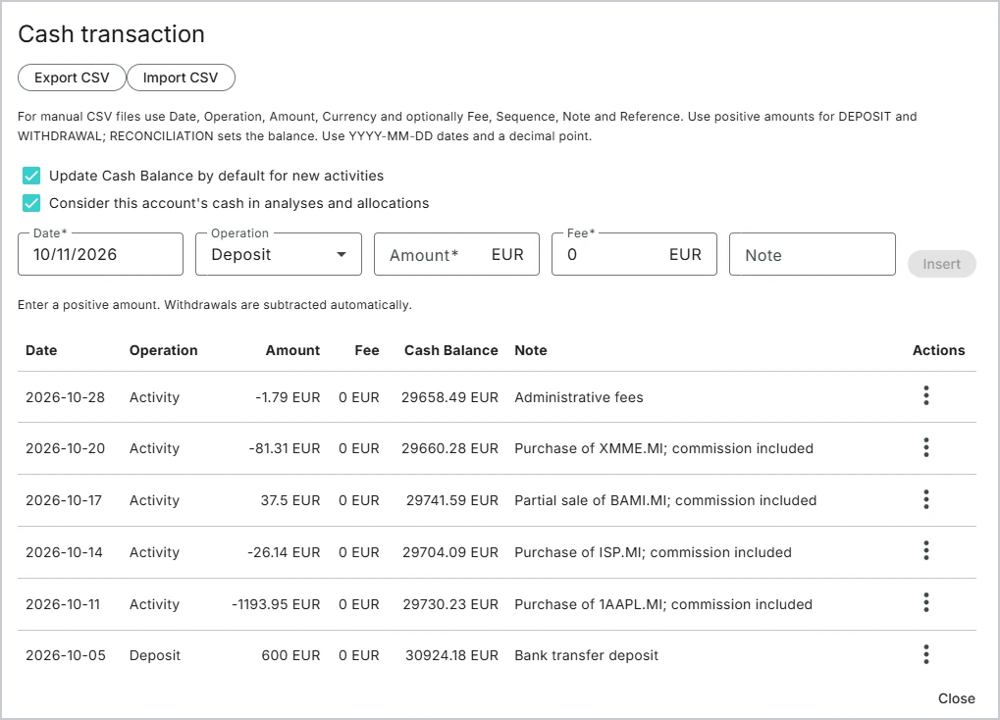
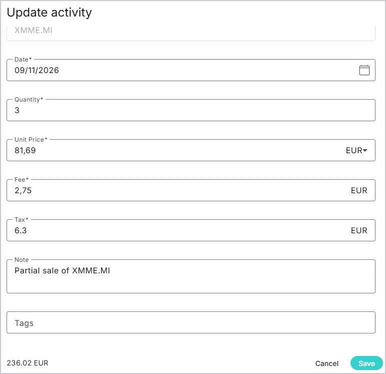
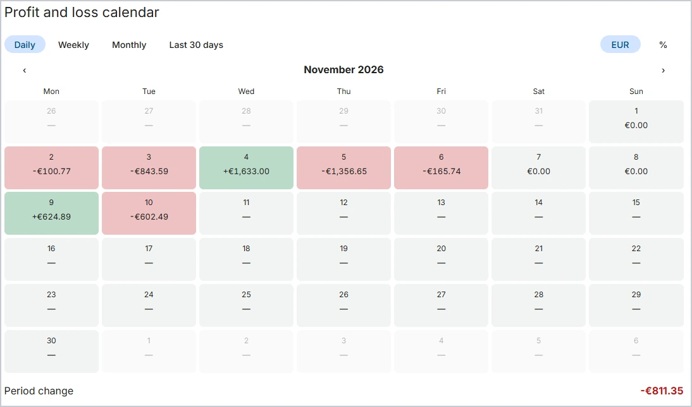
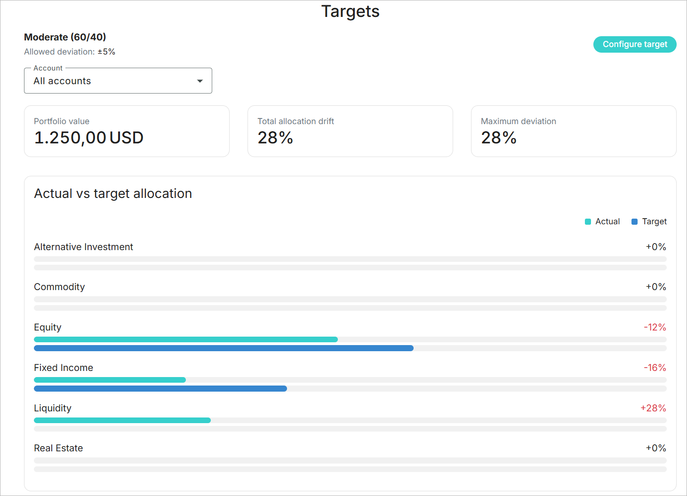
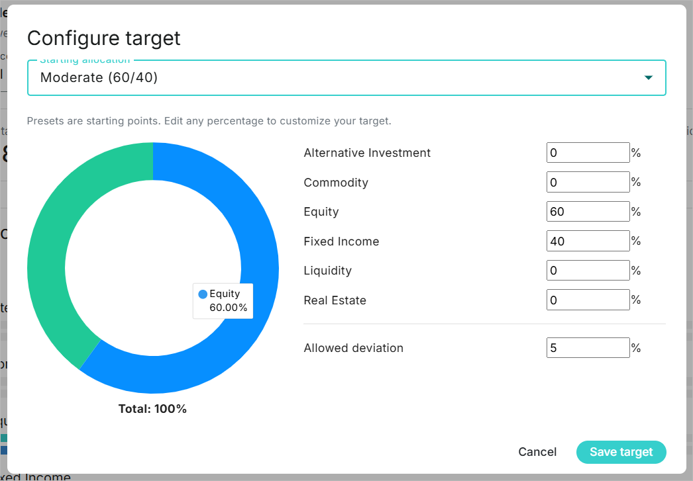
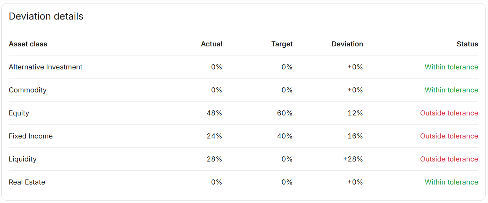
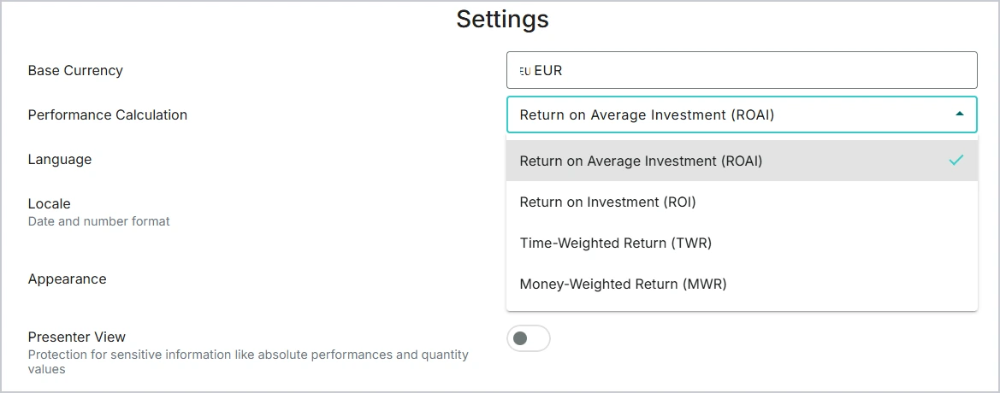

# Ghostfolio-NG

**An independently maintained distribution of [Ghostfolio](https://github.com/ghostfolio/ghostfolio), with additional portfolio-management features, financial calculations, and usability improvements.**

Ghostfolio-NG builds on the original open-source project. It is **not an official Ghostfolio release**, and is not maintained or endorsed by the upstream Ghostfolio team. The original project and its contributors remain the foundation of this distribution.

This document describes the integrated Ghostfolio-NG feature set, rather than changes in a particular release. For the original application, see the [Ghostfolio README](README.md).

## Ghostfolio-NG Features

### Cash Management

Track deposits, withdrawals, reconciliations, and cash transfers alongside investment activities. Account-level preferences control cash balance updates and whether cash is included in portfolio analyses. Cash transactions support a dedicated CSV preview, import, and export workflow. Portfolio JSON restoration is also supported.

Cash movements and investment performance are distinct: moving money into an account does not itself create an investment gain. See [upstream PR #8305](https://github.com/ghostfolio/ghostfolio/pull/8305).

### Tax Management

Record tax amounts separately from fees on buy, sell, dividend, and interest activities. Taxes are retained in supported activity import/export workflows and included in monetary net investment performance. When linked cash updating is enabled, applicable taxes are reflected in the cash movement.

This is tax _recording_, not an automatic tax-rate or filing system. Current TWR and MWR percentage calculations do not explicitly account for the recorded Tax field; use ROI/ROAI when reviewing percentage returns net of recorded taxes. See [upstream PR #8252](https://github.com/ghostfolio/ghostfolio/pull/8252) and the [cash/tax integration notes](docs/ng-cash-activity-tax-integration.md).

### Profit and Loss Calendar

Explore portfolio profit and loss on the Home overview in daily, weekly, monthly, or rolling 30-day views. Switch between monetary amounts and percentage values when permitted by the selected view and performance method.

The calendar represents investment performance, not account deposits or total cash balance changes. Percentage values are calculated separately using ROAI and may be unavailable with other selected performance methods. See [upstream PR #8158](https://github.com/ghostfolio/ghostfolio/pull/8158).

### Portfolio Targets

Define your preferred asset allocation and compare it with your current portfolio under **Portfolio → Targets**. Choose from five editable allocation presets or create a custom strategy.

The overview shows the portfolio value, actual versus target allocation, total allocation drift and maximum deviation. A portfolio-wide view and individual account selection are available.

**Configure your allocation**

Adjust the asset-class percentages and allowed deviation, then save your configuration. Targets are saved globally: selecting an individual account changes the comparison without modifying the saved allocation strategy.

**Analyze allocation deviations**

Review each asset class to see its actual allocation, target percentage, deviation and tolerance status. The comparison helps identify where the portfolio differs from the desired allocation.

**Ghostfolio-NG compatibility**

Portfolio Targets respects excluded accounts and NG's **Include cash in portfolio** preference. Eligible account cash is reconciled separately from securities to avoid double-counting.

Missing or inconsistent financial data and unsupported exposures may make the allocation analysis unavailable. The feature is informational: it does not execute trades, provide investment recommendations or perform automatic rebalancing.

For additional instructions, see **About → Ghostfolio-NG → Portfolio Targets**. Technical details are documented in the [NG integration notes](docs/ng-portfolio-targets-integration.md). See also [upstream PR #8458](https://github.com/ghostfolio/ghostfolio/pull/8458).

### ETF Composition

Ghostfolio-NG enriches ETF country and sector allocations using composition data published by supported ETF issuers.

The initial implementation supports selected ETFs from **iShares (BlackRock)**, **Vanguard**, and **Xtrackers (DWS)**.

Country and sector exposures are normalized to Ghostfolio's existing classifications and integrated into the portfolio allocation views. Incomplete allocations are preserved without artificially scaling them to 100%, and unclassified country exposure remains visible.

Data availability depends on each issuer's published information. Not every ETF is necessarily supported, and issuer data may be delayed or temporarily unavailable.

The shared normalization foundation is proposed in [upstream PR #8469](https://github.com/ghostfolio/ghostfolio/pull/8469). Issuer-specific enhancers are currently maintained in Ghostfolio-NG.

For implementation details, data-quality safeguards and limitations, see the [ETF Composition integration notes](docs/ng-etf-composition-integration.md).

### Financial Performance and Returns

Choose between four return calculations in **Settings → Experimental Features → Performance Calculation**:

| Method   | Interpretation                                                                                  |
| -------- | ----------------------------------------------------------------------------------------------- |
| **ROI**  | Net investment performance relative to invested capital.                                        |
| **ROAI** | Net investment performance relative to average invested capital, weighted by accounting days.   |
| **TWR**  | Time-weighted return, linking subperiod returns to reduce the influence of contribution timing. |
| **MWR**  | Money-weighted return, using dated cash flows and an annualized XIRR calculation.               |

The methods are not interchangeable: TWR is cumulative in this implementation, while MWR is annualized. Return calculations and benchmark comparisons can have different cash-flow, tax, fee, and currency boundaries. See [upstream PRs #8211, #8220, #8221, #8233, and #8288](#upstream-contributions).

## Additional Improvements

Ghostfolio-NG also integrates improvements to realized performance after partial sales, same-day ROI invested-capital handling, editable fee descriptions, and resilience against background portfolio-snapshot refresh failures. Local integration patches preserve exchange-rate context in cached portfolio snapshots and align activity-tax handling with the Unified Cash Ledger.

For the complete inventory and technical provenance, see [integrated-prs.json](docker/integrated-prs.json) and the [technical guide traceability](docs/ghostfolio-ng-guide-traceability.md).

## Upstream Contributions

These pull requests are included in Ghostfolio-NG's integration inventory. **Inclusion here does not mean that a contribution has been merged into upstream Ghostfolio.** Follow the links for the current upstream status.

| PR                                                          | Contribution                                                |
| ----------------------------------------------------------- | ----------------------------------------------------------- |
| [#8211](https://github.com/ghostfolio/ghostfolio/pull/8211) | Use remaining cost basis for realized performance           |
| [#8220](https://github.com/ghostfolio/ghostfolio/pull/8220) | Fix ROI invested capital for same-day transactions          |
| [#8221](https://github.com/ghostfolio/ghostfolio/pull/8221) | Implement time-weighted return calculation                  |
| [#8233](https://github.com/ghostfolio/ghostfolio/pull/8233) | Implement money-weighted return calculation                 |
| [#8288](https://github.com/ghostfolio/ghostfolio/pull/8288) | Use calendar days for ROAI weighting                        |
| [#8158](https://github.com/ghostfolio/ghostfolio/pull/8158) | Add PnL calendar to home overview                           |
| [#8252](https://github.com/ghostfolio/ghostfolio/pull/8252) | Add taxes to activities                                     |
| [#8305](https://github.com/ghostfolio/ghostfolio/pull/8305) | Introduce unified account cash ledger and portfolio restore |
| [#8315](https://github.com/ghostfolio/ghostfolio/pull/8315) | Allow renaming fee activities                               |
| [#8366](https://github.com/ghostfolio/ghostfolio/pull/8366) | Handle background snapshot refresh rejection                |
| [#8458](https://github.com/ghostfolio/ghostfolio/pull/8458) | Add portfolio allocation targets and drift analysis         |

Local integration corrections are tracked separately in [docker/integrated-prs.json](docker/integrated-prs.json); they are not represented as upstream PRs.

## Installation & Updates

Ghostfolio-NG publishes integration Docker releases through the [fork's GitHub Releases](https://github.com/piggei/ghostfolio/releases). The release workflow builds and qualifies Linux **AMD64** and **ARM64** images before publication.

For a reproducible installation, download the `docker-compose.yml` and `ghostfolio.env.example` files from the **same Ghostfolio-NG release**, configure the required secrets and database credentials, and follow the [Docker installation and update instructions](docker/INTEGRATION.md). The application is exposed on port `3333` in the documented Compose setup.

The container registry is `ghcr.io/piggei/ghostfolio-ng`. Prefer a versioned integration release tag for reproducibility; the `integration` tag follows the most recently successfully published integration build. **Back up your database before upgrading**: application startup can apply database migrations. Publishing a new image does not automatically update an existing deployment.

Do not confuse these images with the official `ghostfolio/ghostfolio` images, which do not necessarily include NG features.

## Home Assistant Add-on

Ghostfolio-NG is also available as a native **Home Assistant Add-on** for Linux AMD64 and ARM64.

The add-on provides:

- Native Home Assistant Ingress integration.
- Integrated Redis with persistent storage.
- Persistent application secrets.
- Independent add-on versioning.
- Automated builds, architecture qualification and release publication.

A separate PostgreSQL server is required.

The Home Assistant add-on is maintained in the [`feat/home-assistant-addon`](https://github.com/piggei/ghostfolio/tree/feat/home-assistant-addon) branch.

For installation, configuration, updates and backup instructions, see the [Home Assistant Add-on documentation](https://github.com/piggei/ghostfolio/blob/feat/home-assistant-addon/home-assistant-addon/DOCS.md) and the [add-on repository README](https://github.com/piggei/ghostfolio/blob/feat/home-assistant-addon/home-assistant-addon/README.md).

Ghostfolio-NG integration releases and Home Assistant add-on releases have independent version numbers. The automated publication workflow connects the two distributions while preserving their individual release identities.

## Documentation

- **In-app user guide:** open **About → Ghostfolio-NG** in a Ghostfolio-NG build for step-by-step instructions, worked examples, and current feature limitations.
- **[Technical guide and traceability](docs/ghostfolio-ng-guide-traceability.md):** implementation details, behavior boundaries, regression references, and links to the relevant upstream contributions.
- **[Cash/tax integration notes](docs/ng-cash-activity-tax-integration.md):** details of the interaction between recorded taxes and linked cash movements.
- **[Docker integration guide](docker/INTEGRATION.md):** installation, release artifacts, image tags, and update guidance.
- **[Original Ghostfolio README](README.md):** upstream application information and general project documentation.

## Credits & Acknowledgements

Ghostfolio-NG is maintained by [PJ](https://github.com/piggei) as an independent distribution based on [Ghostfolio](https://github.com/ghostfolio/ghostfolio). Thanks to the original Ghostfolio maintainers and contributors for the open-source foundation.

Development also uses AI-assisted analysis, coding, testing, and documentation with Codex and ChatGPT. These are AI assistants, not human project contributors.

Ghostfolio-NG does not claim affiliation with or endorsement by the upstream Ghostfolio project.
