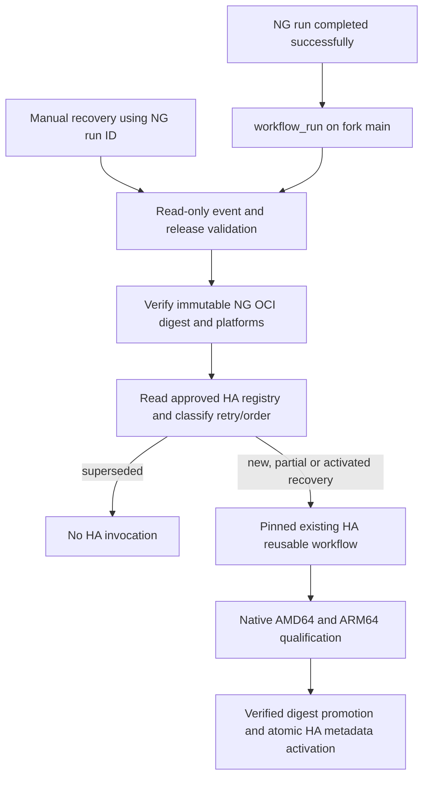

# Ghostfolio NG to Home Assistant post-release orchestrator

## Scope and review status

Task 03A is a local implementation on `feat/ghostfolio-ng-ha-orchestrator`, in
`/home/pj/repo/ghostfolio-ha-orchestrator`, based on the explicitly approved fork
default-branch commit `39926557b558b10b0e8e261ed3598c42e81c9896`.
This is fork-specific automation, not an upstream application change.

The preflight verified that the branch and path were free, the baseline matched
the fork's remote `main`, and all five pre-existing worktrees were clean. Only
the authorized local branch and worktree were created. The official upstream
baseline is distinct: the local upstream ref is release 3.97.0 at
`fb8b12aa7eb2a9f28dc92ec18d7c951743782746`, while the last read-only server
check reported `c861b1adaaa894d752a2088f1a77b35a22eec2ac`. Neither was used as
the orchestrator baseline; no fetch or upstream update was performed.

Historical Task 03A development context (current pin status is in Task 07K below):

- NG: `integration/ghostfolio-all-pr`, commit
  `649d61f90429483cac949c0c97c83d10c13f7c8e`.
- HA at Task 03A: `feat/home-assistant-addon`, approved reusable revision
  `4d642df014071b5c72eb731409aef47507cad641`.
- At Task 03A: HA version `3.97.0`, generation-zero registry, no allocations.

| Status                      | Evidence                                                                                                                                                     |
| --------------------------- | ------------------------------------------------------------------------------------------------------------------------------------------------------------ |
| Implemented locally         | Dedicated workflow, validator, tests and this document                                                                                                       |
| Syntax/static validation    | Node syntax, YAML duplicate-key parsing, actionlint 1.7.12, formatting and whitespace                                                                        |
| Unit tested                 | Event/input/output/transport and workflow contract tests                                                                                                     |
| Mock integration tested     | Actual clients and state functions extracted from the approved HA commit, with simulated GitHub/GHCR responses                                               |
| Verified on GitHub          | Historical NG run `41731193162` and release `integration-3.97.0-15`; HA native CI runs `41752436192` and `41752436252` remain successful at the approved SHA |
| Orchestrator run on GitHub  | Not performed                                                                                                                                                |
| Published orchestrator      | No commit or push authorized in Task 03A                                                                                                                     |
| New HA images/metadata      | Not published or activated                                                                                                                                   |
| Real Home Assistant upgrade | Not performed; separate maintainer validation                                                                                                                |

## Historical Task 05A: qualified controller pin

At Task 05A the three operational references agreed on HA controller
`bfaf9ff86325d3d6fb25c37785e854cc583077df`: the static reusable workflow,
validator checkout and resolver `HA_REVISION` emitted as `addon_source_revision`.
At that checkpoint the registry was generation 1, with `3.97.1` reserved under its original
identity, no qualification/publication evidence, and visible version `3.97.0`.
That failed attempt is abandoned operationally; do not dispatch its recovery.
Changing this pin intentionally does not rewrite the historical reservation.

Task 05A is local validation only. No new commit SHA P exists until a separately
authorized commit. After approval, qualify P in a separate read-only CI harness:
check out the orchestrator at full P and the HA contract at full C; run the
orchestrator tests, HA regressions, actionlint, YAML, syntax and formatting checks.
Use `contents: read`, no package write permission, no invocation of the release
entry point or reusable release job, and no release dispatch. The current
orchestrator has no push/PR validation trigger; pushing its branch alone would
not qualify it on Actions. A harness must be reviewed and authorized separately
before creation or invocation. Do not dispatch the production orchestrator for
validation: its dispatch can publish HA. CI qualification and main activation
are separate approval checkpoints. Before activation verify the committed diff
contains only this pin change and tests/documentation, then verify P remotely.
Future qualifying NG releases may publish through C after main activation;
no historical event is automatically recovered.

## Task 07K: controller D pin proposal

The three operational pins now agree on qualified controller D,
`a695d99ca3593a02c95c78f096b3ebb930fb13e8`: the reusable workflow, validator
checkout and resolver `HA_REVISION`. D passed independent unit/API CI run
`41929010254` (231 tests), native AMD64 run `41930186705` and native ARM64 run
`41930186708`. Native application/persistence checks used the existing immutable
bootstrap NG image pin; they do not qualify a future NG image automatically.

This proposal starts at current main P,
`f6ea73ca1f28750abd3b061023cab6a4f3443638`, and is local and uncommitted. Q does
not yet exist. Before publishing or activating Q, separately authorize its commit,
qualify its exact SHA against exact D in a read-only harness, and review the
main fast-forward. Existing P/C or F/D-only CI does not qualify the new Q.

The registry remains generation 3, visible version `3.97.0`, current release null.
Historical `3.97.1` keeps revision `4d642df014071b5c72eb731409aef47507cad641`;
`3.97.2` keeps revision `bfaf9ff86325d3d6fb25c37785e854cc583077df`, its AMD64
evidence and no ARM64/publication evidence. Both are abandoned operationally,
while their stored state stays `reserved`. Do not change their identities, clear
evidence, allocate again for them, dispatch their NG runs or attempt recovery.

With D, selecting NG release 15 or 16 conflicts with its historical identity and
fails closed before the HA reusable job. It is not silently converted into a new
release or skipped as successful recovery. The unchanged retry contract remains
idempotent for an identical D identity; this pin does not disable legitimate
future retries or historical activation safety checks.

A genuinely new, independently published NG release with a run number greater
than 16 is required for the next fresh HA release. Changing only the controller
revision for the already published NG release 16 is not sufficient. Provenance
still binds the canonical run/attempt, successful release job, source commit,
GitHub release/tag, immutable OCI index and native image architecture/revision.
Do not invent a release number or relabel an existing image to bypass those checks.
With upstream still `3.97.0`, the allocator would assign `3.97.3`; an upstream
version greater than `3.97.2` takes precedence instead. Resolution only simulates
allocation; actual reservation requires the separately authorized publication.

Local validation uses the immutable D contract and includes 110 orchestrator
tests plus 231 HA regressions. Added cases reject both historical controller
identities and resolve a mock independently published NG release 17 without
mutating either old record or emitting any write request. No production identity,
permission, concurrency group, provenance check or publication gate changes.

## Files and architecture

Only these five files are added to the dedicated branch:

- `.github/workflows/ghostfolio-ng-ha-orchestrator.yml`
- `scripts/ghostfolio-ng-ha-orchestrator.mjs`
- `scripts/ghostfolio-ng-ha-orchestrator.test.mjs`
- `scripts/ghostfolio-ng-ha-orchestrator-workflow.test.mjs`
- `docs/ghostfolio-ng-ha-orchestrator.md`

No NG or HA implementation is copied into this branch, and no package manifest,
lockfile, application, existing workflow or runtime configuration is changed.



The main workflow has two jobs. `resolve` uses only read permissions. `release-ha`
receives write permissions only if resolution succeeded and its validated output
`should_publish` is exactly `true`. There is no dependency back to NG: failure
in this separate orchestrator cannot change the result of an already completed
NG workflow.

## Event and source provenance

The automatic trigger is `workflow_run` for `Publish integration Docker release`,
activity `completed`, branch `integration/ghostfolio-all-pr`. A coarse job
condition excludes unsuccessful predecessors. The Node validator then checks:

- Caller and event repository exactly `piggei/ghostfolio`.
- Execution on the fork default branch `refs/heads/main`, with a full SHA.
- Event action `completed`; exact NG branch, workflow path and workflow name.
- NG event only `push` or `workflow_dispatch`, never a PR event.
- Source/head repository exactly the expected fork, not an external fork.
- Positive safe-integer run ID, number, attempt and workflow ID; lowercase full
  40-character source commit.
- Optional top-level workflow information consistent with the nested run.

The registered workflow is read from the fixed GitHub API endpoint. The canonical
run must match its ID/path/name and the triggering event's run ID, attempt, number
and commit. Both canonical status and conclusion must be `completed`/`success`.
The approved HA provenance validator also requires a single matching successful
`release` job in the explicitly selected latest attempt. Earlier attempts are
never combined to manufacture success. The canonical run is checked again after
release, OCI and HA-registry validation; a retry starting during resolution fails.

Manual recovery accepts only `ng_run_id`, as a canonical positive integer string.
Every other identity field is derived from the same canonical API checks. It does
not accept a caller-supplied image, branch, source commit, workflow path or script.
`workflow_dispatch` is a potentially publishing operation, not a dry-run. If
validation accepts a new or partial release, it can build/qualify HA candidates,
publish final images, update the HA branch and create its release tag. Recovery
of an activated release can repair its missing tag. Dispatch requires explicit
publication authorization, even when its purpose is recovery or bootstrap.

## Exact release and digest resolution

The validator reads `package.json` as JSON at the canonical NG commit. It never
checks out or executes that source. The version must have exactly three numeric
components. The release tag is constructed from the existing generator contract:
`integration-<package-version>-<NG-run-number>`. The current NG workflow derives
the suffix from `GITHUB_RUN_NUMBER`, not the attempt number.

Only that tag is queried. There is no latest-release query and no lookup of the
mutable `integration` image tag. The GitHub release must be published, non-draft,
non-prerelease, and have `target_commitish` equal to the canonical source SHA.
The peeled Git tag must resolve to that same commit. The four canonical release
metadata lines generated by `scripts/integration-release.mjs` must each occur
exactly once, without conflicting or indented duplicate fields:

- Source commit URL and short identifier.
- Exact versioned `ghcr.io/piggei/ghostfolio-ng:<integration-tag>` reference.
- Exact immutable commit tag.
- AMD64/ARM64 support declaration.

The metadata is checked again before outputs are emitted. Generator format
changes require review; inconsistent metadata fails closed rather than falling
back to a different release.

The actual versioned GHCR manifest is fetched, hashed, and validated by the
approved HA registry client. The resolved value passed to HA is always:

```text
ghcr.io/piggei/ghostfolio-ng@sha256:<digest-computed-from-actual-manifest>
```

No historical image digest appears in the implementation. The shared OCI validator
requires exactly one runnable Linux AMD64 and one ARM64 descriptor, validates
child manifest and config content digests, checks the actual config architecture
and source revision labels, and compares both release and commit tags with the
resolved digest. Identified attestation descriptors are handled by that existing
validator. A tag alone, labels alone, or a successful job without a successful
completed run cannot establish a qualified release.

## Current controller: HTTP read retries

The active Home Assistant 3.97.4 release was published using controller D,
`a695d99ca3593a02c95c78f096b3ebb930fb13e8`. Its immutable release identity and published image digests
remain unchanged.

For subsequent releases, the qualified controller proposed for activation is
`83ecb8df43e3d73f0435931b5fca778856711943`. It adds bounded retries for transient GitHub and GHCR
HTTP GET transport failures, including response-body reads. HTTP error
responses are not automatically retried, and GitHub write operations
retain their existing recovery and idempotency safeguards.

The controller was qualified on GitHub Actions:

- HTTP regression and native AMD64/ARM64 qualification:
  run `42118693519` (success).
- Standard Home Assistant AMD64 qualification:
  run `42119386101` (success).
- Standard Home Assistant ARM64 qualification:
  run `42119385995` (success).

The updated orchestrator passed 110 local regression tests using the
exact immutable controller snapshot. Its new revision has not yet been
committed, independently qualified in CI, or activated on the default
branch.

Historical Home Assistant releases retain their original controller
revisions. Updating the orchestrator pin does not rewrite release
identities, allocate new versions, or recover previous releases.

## Reusing the immutable HA contract

The reference is literal and cannot be supplied through event fields:

```text
piggei/ghostfolio/.github/workflows/home-assistant-addon.yml@83ecb8df43e3d73f0435931b5fca778856711943
```

The resolver checks out only its trusted default-branch revision (`github.sha`)
and the approved HA revision, the latter into `ha-contract` with sparse checkout.
It imports only these approved library modules:

- `home-assistant-addon-github.mjs`: source/job/attempt and HA revision checks.
- `home-assistant-addon-http-read.mjs`: bounded retries for transient HTTP GET transport failures.
- `home-assistant-addon-oci.mjs`: authenticated manifest/config digest checks.
- `home-assistant-addon-release.mjs`: schema, version/order and retry validation.

The publication CLI is not imported or executed. The libraries are checked out
from the approved SHA, not downloaded from NG artifacts or from an event-provided
ref. The resolver's transport is additionally restricted to GET requests and
allowlisted API hosts/repository paths, so even an accidental call to a mutation
method in the shared client would fail before reaching the network.

| HA input                | Origin                                       |
| ----------------------- | -------------------------------------------- |
| `integration_tag`       | Canonical package version plus NG run number |
| `source_commit`         | Validated canonical NG `head_sha`            |
| `source_image`          | Actual verified OCI index digest             |
| `ghostfolio_version`    | Canonical source `package.json`              |
| `addon_source_revision` | Constant approved HA SHA                     |

The five fields match the approved callee's required string inputs. Its existing
outputs remain `addon_version`, `amd64_digest`, `aarch64_digest`, `metadata_commit`
and `publication_status`. No dynamic `uses`, alternate dispatch replacement or
new HA implementation is introduced. Same-repository cross-branch calls are
supported by GitHub; the callee explicitly checks out the passed HA revision.
Actual execution with write permissions remains an authorized deployment test.

## Permissions and security

| Job              | Permissions                                        |
| ---------------- | -------------------------------------------------- |
| Workflow default | `contents:read`                                    |
| `resolve`        | `contents:read`, `actions:read`, `packages:read`   |
| `release-ha`     | `contents:write`, `actions:read`, `packages:write` |

Only already approved `actions/checkout@v4` and `actions/setup-node@v4` actions
are used. Checkout credentials are not persisted. `GITHUB_TOKEN` is provided only
to the resolver step and is read-only there; the reusable job receives the exact
permissions required by its existing implementation. No PAT, new secret, settings
change, inherited secret bundle, PR write permission or OIDC grant is needed.

Neither event input nor API data is interpolated into shell commands. Runtime
logic uses structured JSON, fixed endpoints and validated identifiers. No scripts,
caches or artifacts from the triggering run are executed or downloaded. Output
fields are allowlisted and validated before a single output write; failures leave
no partial job outputs. CLI errors are generic and do not reflect event/API bodies
or credentials. Config-blob redirects are restricted to HTTPS GHCR/GitHub package
hosts, with authorization headers removed on the redirected request. Unknown
redirect destinations fail closed.

## Idempotency, ordering and concurrency

The authoritative state remains on the HA branch. The resolver reads and validates
the existing registry and current manifest; it never saves them or reserves a
version remotely. It exercises the approved allocation function only in memory.

- New identity: delegate allocation and publication to HA.
- Existing partial identity: require exact equality of all five immutable fields
  and delegate recovery, preserving the reserved version.
- Unknown or incomplete identity older than the newest HA reservation: report
  `superseded` and skip the HA job.
- Already activated identity: delegate verification/tag repair to HA. This is
  intentional: skipping every activated record would break recovery after a
  successful metadata commit followed by a failed Git-tag creation. The approved
  HA machine makes these invocations no-ops for version allocation and metadata,
  including historical retries after a newer activation.
- Conflicting identity or run number: fail, never allocate a replacement.

Duplicate events can repeat validation and invoke the idempotent HA recovery path;
they do not create duplicate versions or publication side effects. There is no
second allocation ledger or artifact-retention-based deduplication mechanism.

The parent concurrency group is `ghostfolio-ng-ha-orchestrator`; the immutable
child uses `ghostfolio-home-assistant-release`; NG uses `integration-release`.
All have `cancel-in-progress: false`. Parent/child groups are distinct, preventing
self-cancellation or a parent waiting while holding the child's lock. The child
also serializes external HA entry points and rechecks the real branch/registry
before each persisted transition. A stale read in the resolver is never authority
to overwrite newer metadata: the child remains the final authority.

GitHub concurrency is not a durable FIFO queue and can replace pending requests.
It does not guarantee release-event or dispatch order. With the current default
pending limit, `cancel-in-progress: false` protects the running publication but
does not protect an older pending request from replacement.
If a particular skipped/pending release needs attention, use the explicit recovery
entry point after reviewing current HA ordering. No force-push, version rollback,
NG rebuild or implicit retry loop is used.
Manual recovery uses the same ordering checks: an older unknown/partial release
is superseded, while an activated historical release can only recover its own
tag without changing the current HA version or pointer. The child rechecks state
under its own concurrency group, so manual recovery cannot bypass these guards.

## Local test and validation procedure

No npm installation or application build is required. The mock integration tests
use the exact approved library files, extracted from the local Git object store.
The approved HA commit must already exist locally, as in the shared worktree
environment. This creates a temporary source snapshot, not a branch or worktree:

```bash
(
  set -euo pipefail
  task03_contract="$(mktemp -d)"
  trap 'rm -rf "$task03_contract"' EXIT
  git archive 83ecb8df43e3d73f0435931b5fca778856711943 \
    scripts/home-assistant-addon-github.mjs \
    scripts/home-assistant-addon-http-read.mjs \
    scripts/home-assistant-addon-oci.mjs \
    scripts/home-assistant-addon-release.mjs \
    .github/workflows/home-assistant-addon.yml |
    tar -x -C "$task03_contract"
  HA_CONTRACT_DIR="$task03_contract" node --test \
    --experimental-test-isolation=none scripts/ghostfolio-ng-ha-orchestrator*.test.mjs
)
actionlint .github/workflows/ghostfolio-ng-ha-orchestrator.yml
git diff --check
```

Coverage includes invalid/fork/PR/failed/cancelled/incomplete events, malformed
IDs/attempts/commits, canonical API mismatches, exact release selection, metadata
collisions, missing images/platforms, config/source/digest drift, job/attempt
ambiguity, read-only retry, duplicate identity, newer reservation, historical
activation recovery, source drift, output injection, token containment and blob
redirect handling. Workflow tests load the approved callee and verify every input,
output, immutable reference, permission grant, checkout and concurrency group.

Regression checks also run the unchanged HA Node suite and the relevant existing
NG release generator, workflow and OCI-manifest test suites. Syntax checks cover
all new Node files. YAML parsing uses duplicate-key detection; Prettier uses the
repository configuration and already installed tooling, without dependency
changes. The sole workflow shell command is a fixed Node invocation; Bash syntax
and ShellCheck apply to that command. No new standalone Bash script is introduced.

Task 03A validation results: **266 passing Node tests**, zero failures, zero
skips: 107 new orchestrator tests, 110 unchanged HA tests and 49 unchanged NG
regression tests. Node syntax checks, actionlint 1.7.12, Bash syntax, ShellCheck,
YAML parsing with duplicate-key detection, Prettier and whitespace checks all
passed. Untracked additions were checked individually with
`git diff --no-index --check`; ordinary `git diff --check` alone would not cover
them. No software or dependencies were installed.

At the Task 03A checkpoint, the branch remained at the approved baseline, with
exactly the five listed files untracked and an empty staging area. All five
pre-existing worktrees remained clean at their original commits. No commits,
remote writes, workflow executions, image publications or registry allocations
were performed.

## Controlled bootstrap plan (not executed)

1. Review the five-file diff, local/static/mock test evidence and this security
   model. Approve any changes before committing. Keep NG and HA branches separate.
2. After separate authorization, create the orchestrator-only commit on the
   dedicated branch and publish it. Record its actual full SHA; do not invent a
   SHA before that commit exists. Pushing this branch does not activate the new
   workflow because it has no push trigger and is not on the default branch.
3. Verify the committed workflow, script and tests against that exact remote SHA,
   including the unchanged literal HA reference. Repeat actionlint on the
   published workflow and verify caller/callee inputs and token grants.
4. Obtain separate approval for introducing only the reviewed orchestration files
   on the fork's default branch. Review any intervening main changes first. Do not
   merge the HA or NG feature branches into main and do not update official
   upstream. The exact integration method is a later publication decision.
   Introducing the workflow on main enables automatic HA publication for future
   qualifying NG completion events; it is an activation boundary, not a passive
   registration test. Before that update, coordinate a quiet NG release window:
   verify no NG release run is running or queued, and arrange no new NG releases
   until activation/publication is explicitly authorized. An NG run started before
   registration but completing afterward may trigger HA. If this cannot be
   controlled, stop before updating main; do not treat branch-publication approval
   as authorization to activate on main.
5. Before that main update, review existing main-triggered workflows and their
   side effects. In particular, `extract-locales.yml` runs on main pushes and may
   create a localization PR if its output changes. No existing workflow is
   modified here. Do not create a version tag as a bootstrap shortcut: the existing
   Docker CD workflow listens to semantic-version tags.
6. Verify default-branch workflow registration and Actions policy. Confirm read
   access to NG run/release/package metadata, `GITHUB_TOKEN` access to HA packages,
   and permission for the approved HA controller to update its branch and create
   its version tag. Inspect branch/tag rules without changing them implicitly.
   Checkouts and public same-repository visibility are verified statically, but
   real mutation rights cannot be proved by the local mocked tests.
7. NG completions predating registration do not generate retrospective events.
   No historical event is automatically replayed, marked recovered or recorded
   as processed by this bootstrap procedure.
   For the first separately authorized end-to-end run, dispatch this orchestrator
   from `main` with `ng_run_id: "41731193162"` only after revalidating that historical
   run. The validator resolves the actual digest at execution time. Do not rerun
   NG to bootstrap HA. This dispatch can publish HA images and metadata; it is
   not a bootstrap dry-run. Neither Task 03A nor Task 03B authorizes that operation.
8. Inspect the separate orchestrator and nested HA jobs on both native runners.
   Verify both final image digests, the coherent HA metadata commit, registry
   transitions and version tag, then let maintainers validate the Supervisor update
   and persistence against their real installation and database backups.

`workflow_run` and `workflow_dispatch` both need the workflow on the default branch.
The additional context gate intentionally rejects manual dispatch from feature
branches. The automatic path remains `workflow_run`; dispatch is only recovery.
The pinned HA workflow does not have to be copied to main or exposed as its own
manual workflow. A completed successful NG run satisfies its strict source gate
without the deadlock inherent in a blocking child inside the NG run itself.

## Recovery, rollback and remaining risks

If HA fails, retain the NG release, its tags/images, and the completed NG run.
Inspect the existing HA registry and real GHCR state. Re-run **all jobs** of the
orchestrator or dispatch it from main with the same NG run ID. The immutable
identity is resolved again; the existing HA state machine retains the version,
recovers partial uploads/publications, and repairs a missing HA tag after
activation. Never launch NG to retry HA. A stale NG attempt or a partial latest
attempt without a successful release job fails closed and requires maintainer
review rather than automatic fallback to an older attempt.

For an ordering skip, inspect the newer reservation/current HA metadata first.
Do not delete allocations, rewrite image tags, move Git tags, force-update a
branch or advertise a lower version. Exceptional maintenance of a historical
partial release requires its own explicit recovery decision.

To stop future automation after activation, obtain approval to disable the new
workflow or revert only its orchestration files with a new ordinary commit.
Do not alter published NG state or roll back HA metadata automatically. Stopping
future triggers does not stop an in-flight child; inspect its phase before any
separately authorized cancellation. An application/database rollback is a separate
maintainer operation requiring verified compatibility and backups, preferably a
new forward-version release.

Residual limitations: no real cross-workflow execution or HA publication has been
performed; write permissions, default-branch registration and actual Supervisor
upgrade remain deployment checks. GHCR tags have no compare-and-swap API, so
uncoordinated writers must not publish to the same repositories. Release metadata
format, repository/default branch, pinned HA revision and redirect-host allowlists
are deliberately fixed; changes require review. Pending-event replacement is a
GitHub concurrency behavior, not a durable release queue.

References:

- [Workflow-run/default-branch behavior and security](https://docs.github.com/en/actions/reference/workflows-and-actions/events-that-trigger-workflows#workflow_run)
- [Reusable workflow inputs, outputs and literal revisions](https://docs.github.com/en/actions/how-tos/reuse-automations/reuse-workflows)
- [Same-repository access, token permissions and concurrency](https://docs.github.com/en/actions/reference/workflows-and-actions/reusing-workflow-configurations)
